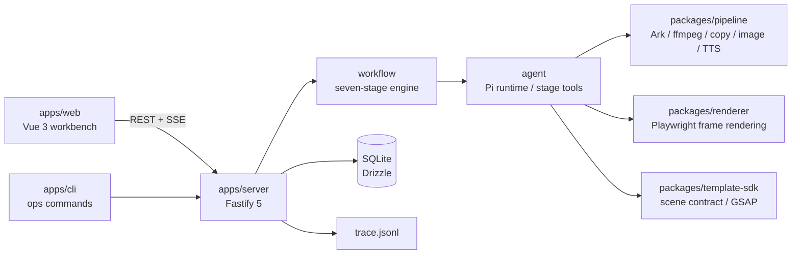

# VideoForge (vedio--generator)

[简体中文](README.md) | English

[](https://github.com/swhite-cn/vedio--generator/actions/workflows/ci.yml)
[](LICENSE)
[](https://nodejs.org)
[](https://pnpm.io)

A **local-first AI video generation harness for Windows**. Built around the **Capability → Project → Run**
domain, it drives a deterministic seven-stage pipeline
(`copy → images → scenes → TTS → storyboard → render → compose`) from a capability registry, executes each
stage through an embedded Pi agent runtime, and records a three-level trace (`run_stages` / `tool_calls` /
`llm_calls`) into both SQLite and a per-project `trace.jsonl`.

> 中文简介：本项目是一个面向 Windows 本机的本地 AI 视频生成 harness，按能力注册表驱动七阶段确定性流水线，
> 内嵌 Pi agent 运行时执行阶段工具，并把三级留痕同时写入 SQLite 与项目目录下的 `trace.jsonl`。

## Highlights

- **Deterministic seven-stage workflow** — stage order, tool names and artifact checks come from the
  capability declaration; the engine hard-codes no stage knowledge.
- **Embedded agent runtime** — powered by `@earendil-works/pi-coding-agent`. Stage tools accept no path
  parameters; the project directory is injected by the runtime.
- **Review gates and resumable runs** — gates are placed after `copy` and `image`; artifact file existence is
  the single source of truth for resuming.
- **Three-level tracing** — `run_stages` / `tool_calls` / `llm_calls` are dual-written to SQLite and
  `<project>/trace.jsonl`, with secret redaction applied on every path.
- **Live workbench** — a Vue 3 + Ant Design Vue console that streams stage progress, tool cards, assistant
  text and review cards over SSE.
- **Multi-user isolation** — JWT auth, actor-first repositories, per-user project directories; the server
  binds to `127.0.0.1` only.

## Architecture



```text
apps/
  server/           Fastify API, workflow engine, agent runtime, trace, SQLite
  web/              Vue 3 workbench (/login /projects /projects/:id /runs/:id/trace /settings /admin)
  cli/              doctor / status / db:migrate / db:user / storage:prune / project:verify
packages/
  shared/           domain types, capability registry, error codes
  pipeline/         config, Ark client, ffmpeg/ffprobe, copy/image/TTS/storyboard/compose
  renderer/         Playwright single-scene and multi-scene frame rendering
  template-sdk/     scene contract, built-in animation templates, profiles, GSAP vendoring
config/             default config, local config template, prompt sets, output profiles
tests/              Vitest unit tests (tests/integration is the real-machine smoke suite, excluded by default)
docs/               developer/operator guides, Pi SDK notes, design documents (Chinese)
```

## Requirements

- **Node.js ≥ 22.19.0** (required by the Pi SDK `engines` field; see `.nvmrc`).
- **pnpm 10.x** (run `corepack enable` to honor the `packageManager` field).
- **Windows 10/11** as the primary and verified platform; Linux/macOS are untested.
- **ffmpeg / ffprobe** available on `PATH`, or absolute paths configured in `config/system.local.yaml`.
- **Chromium** managed by Playwright (`pnpm exec playwright install chromium` on first use if needed).
- A **Volcengine Ark** account for copy generation, images and TTS (`ARK_API_KEY` plus a usable model ID).

## Quick Start

```powershell
# 1) Install dependencies
pnpm install

# 2) Create your local config
Copy-Item config/system.local.example.yaml config/system.local.yaml
#    Edit config/system.local.yaml: set ark.chat_model and runtime.storage_root

# 3) Configure secrets (repo-root .env.local only; never commit it)
Copy-Item .env.example .env.local
#    Fill in:
#    ARK_API_KEY=<your Ark API key>
#    JWT_SECRET=<random string, at least 32 characters>

# 4) Environment self-check
pnpm run doctor

# 5) Start the API (terminal A)
$env:JWT_SECRET = "videoforge-local-dev-secret-key-0123456789"
pnpm run server:dev

# 6) Start the workbench (terminal B)
pnpm run web:dev
#    Open http://localhost:5173
```

The initial account is `admin`; its password is the built-in default or the value of
`VF_ADMIN_INITIAL_PASSWORD`. The first login forces a password change.

## Configuration and Secrets

- Defaults live in `config/default.yaml`; local overrides go to `config/system.local.yaml`
  (gitignored; template: `config/system.local.example.yaml`).
- Secrets are only allowed in `.env.local` or same-named environment variables:
  `ARK_API_KEY`, `JWT_SECRET`, `VF_ADMIN_INITIAL_PASSWORD`.
- The Ark `base_url` **must stay** `https://ark.cn-beijing.volces.com/api/plan/v3`; switching to `/api/v3`
  incurs additional billing.
- While `chat_model` is the placeholder `PLEASE_FILL_CHAT_MODEL_ID`, the `copy` stage refuses to run.
- Prompts are configurable: three template files under `config/prompts/<set>/`; the default set is chosen by
  `prompts.default_set`.

## Commands

| Command                                     | Description                                        |
| ------------------------------------------- | -------------------------------------------------- |
| `pnpm install`                              | Install workspace dependencies                     |
| `pnpm run doctor`                           | Environment and config self-check (JSON summary)   |
| `pnpm run server:dev`                       | Start the API (requires `JWT_SECRET`)              |
| `pnpm run web:dev`                          | Start the Vite dev server for the workbench        |
| `pnpm test`                                 | Run all unit tests                                 |
| `pnpm run test:coverage`                    | Run tests with coverage                            |
| `pnpm run typecheck`                        | `tsc --noEmit` for server / cli / packages         |
| `pnpm run format` / `pnpm run format:check` | Prettier write / check                             |
| `pnpm build`                                | Build all packages and the web app                 |
| `pnpm test:smoke`                           | Real-Chromium smoke test (not part of `pnpm test`) |

CLI ops commands (`apps/cli`): `status`, `db:migrate`, `db:user`, `storage:prune`, `project:verify`.
stdout carries a single machine-readable JSON line, diagnostics go to stderr; unknown commands exit with 2,
failures with 1.

## Screenshots

| Workbench                                     | Run trace                             |
| --------------------------------------------- | ------------------------------------- |
|  |  |

More screens in `design-mockups/` (login, project list, capability center, admin view).

## Data and Tracing

- Domain boundaries are Project → Session → Run; `run_stages`, events and review records are append-only.
- Artifacts, SQLite and `trace.jsonl` live under `runtime.storage_root`, isolated per user.
- Each `trace.jsonl` line is one JSON object whose `type` is `run_stage`, `tool_call` or `llm_call`, ready for
  offline analysis without database access.
- **LLM full-text tracing is on by default** (`llm_calls` stores complete prompts/responses). Expect storage
  growth and treat generated traces as sensitive data.

## Security Notes

- The server listens on `127.0.0.1` only and is **not meant to be deployed publicly**; do not bind it to a
  public interface.
- `agent.allow_shell_write_edit` defaults to `true`, which grants the agent `bash` / `write` / `edit`.
  Disable it if you do not need those capabilities.
- Scene generation copies `gsap.min.js` into each project's `vendor/` directory; redistributing generated
  output is subject to GreenSock's license terms.
- Never commit secrets, tokens, `.env.local`, `config/system.local.yaml`, SQLite databases or generated
  artifacts.
- Please report vulnerabilities privately as described in [SECURITY.md](SECURITY.md); never paste secrets in
  public issues.

## Known Limitations

- End-to-end validation against the real Ark service is still manual; `pnpm test:smoke` only covers the real
  Chromium rendering segment.
- `POST /api/runs/:id/cancel` marks the run `canceled` but does not abort the in-flight stage.
- The trace "events" tab has no backend query route yet; `GET /api/admin/projects` does not derive project
  status.
- The new-project dialog exposes a fixed set of two output profiles.
- There is no ESLint rule set yet; style is enforced by Prettier plus `tsc`.

## Roadmap

- [ ] Cooperative cancellation for in-flight stages
- [ ] Trace "events" timeline query API
- [ ] Profile listing API and more output formats
- [ ] ESLint rule set and stricter CI quality gates
- [ ] Linux / macOS compatibility validation

## Contributing

Issues and pull requests are welcome. Please read [CONTRIBUTING.md](CONTRIBUTING.md) and
[CODE_OF_CONDUCT.md](CODE_OF_CONDUCT.md) first, then run:

```powershell
pnpm run typecheck
pnpm test
pnpm build
```

## Documentation

Most design and guide documents are written in Chinese:

- [Developer guide](docs/guides/developer-guide.md)
- [Operator guide](docs/guides/operator-guide.md)
- [Local harness design](docs/本地视频流水线Agent-v2.md)
- [Web workbench design](docs/本地视频流水线Agent-web-v2.md)
- [Harness rebuild plan](docs/superpowers/plans/2026-10-25-videoforge-harness-rebuild.md)
- [Pi Agent SDK notes](docs/notes/pi-sdk-api.md)

## License

[MIT](LICENSE) © 2026 swhite-cn

## Acknowledgements

- [Pi Agent SDK](https://www.npmjs.com/package/@earendil-works/pi-coding-agent) for the agent runtime
- [Fastify](https://fastify.dev/), [Drizzle ORM](https://orm.drizzle.team/),
  [better-sqlite3](https://github.com/WiseLibs/better-sqlite3)
- [Vue 3](https://vuejs.org/), [Vite](https://vite.dev/), [Ant Design Vue](https://www.antdv.com/)
- [FFmpeg](https://ffmpeg.org/), [Playwright](https://playwright.dev/), [GSAP](https://gsap.com/)
- Volcengine Ark for language, image and speech capabilities
