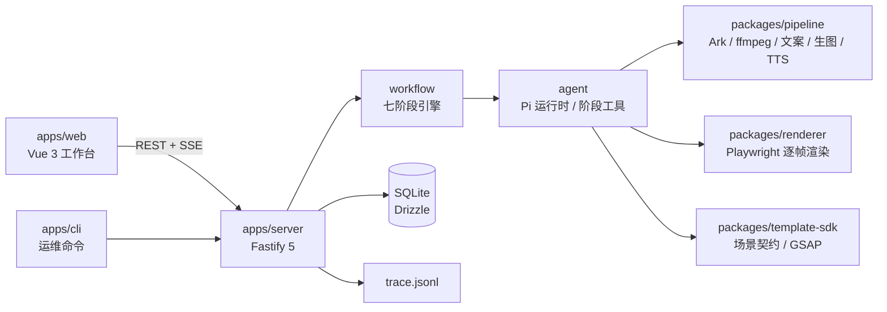
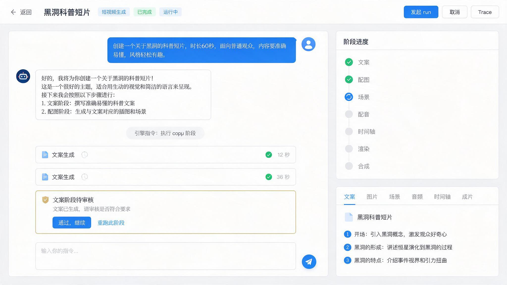
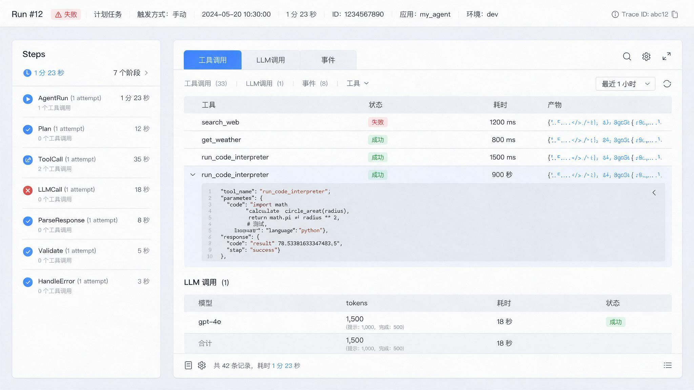

# VideoForge（vedio--generator）

简体中文 | [English](README.en.md)

[](https://github.com/swhite-cn/vedio--generator/actions/workflows/ci.yml)
[](LICENSE)
[](https://nodejs.org)
[](https://pnpm.io)

面向 Windows 本机的**本地 AI 视频生成 harness**：以「能力 → 项目 → run」为主线，按能力注册表驱动
`文案 → 配图 → 场景 → 语音 → 时间轴 → 渲染 → 合成` 七阶段确定性工作流，内嵌 Pi agent 运行时执行阶段工具，
并把 `run_stages` / `tool_calls` / `llm_calls` 三级留痕同时写入 SQLite 与项目目录下的 `trace.jsonl`。

> English: VideoForge is a local-first, Windows-oriented AI video generation harness. It runs a deterministic
> seven-stage pipeline (copy → images → scenes → TTS → storyboard → render → compose) driven by a capability
> registry, executes each stage through an embedded Pi agent runtime, and records a three-level trace
> (`run_stages` / `tool_calls` / `llm_calls`, plus a per-project `trace.jsonl`).

## 核心特性

- **确定性七阶段工作流**：阶段顺序、工具名与产物判据全部来自能力声明，引擎不硬编码阶段知识。
- **内嵌 agent 运行时**：基于 `@earendil-works/pi-coding-agent`，阶段工具入参不含路径，项目目录由运行时注入。
- **审核点与断点续跑**：审核点固定在 `copy`、`image` 之后；以产物文件存在性为唯一断点依据。
- **三级留痕**：`run_stages` / `tool_calls` / `llm_calls` 双写 SQLite 与 `<项目>/trace.jsonl`，全链路脱敏。
- **实时工作台**：Vue 3 + Ant Design Vue 工作台，通过 SSE 展示阶段进度、工具卡片、流式文本与审核卡片。
- **多用户隔离**：JWT 鉴权、actor-first 仓储、项目目录按用户隔离，服务默认仅监听 `127.0.0.1`。

## 架构



```text
apps/
  server/           Fastify API、工作流引擎、agent 运行时、trace、SQLite
  web/              Vue 3 工作台（/login /projects /projects/:id /runs/:id/trace /settings /admin）
  cli/              doctor / status / db:migrate / db:user / storage:prune / project:verify
packages/
  shared/           领域类型、能力注册表、错误码
  pipeline/         配置、Ark 客户端、ffmpeg/ffprobe、文案/生图/TTS/时间轴/合成
  renderer/         Playwright 单场景与多场景连续帧渲染
  template-sdk/     场景契约、内置动画模板、Profile、GSAP 供应商
config/             默认配置、本机配置模板、提示词集、输出 Profile
tests/              Vitest 单测（tests/integration 为真机冒烟，默认排除）
docs/               开发/操作说明、Pi SDK 核对笔记、设计文档
```

## 前置要求

- **Node.js ≥ 22.19.0**（Pi SDK 的 `engines` 要求；见 `.nvmrc`）。
- **pnpm 10.x**（`corepack enable` 后自动使用 `packageManager` 字段指定的版本）。
- **Windows 10/11**（主要目标平台；Linux/macOS 未做验收）。
- **ffmpeg / ffprobe** 可在 PATH 中调用，或在 `config/system.local.yaml` 指定绝对路径。
- **Chromium**：由 Playwright 管理（首次使用可能需要 `pnpm exec playwright install chromium`）。
- **火山方舟（Ark）账号**：用于文案、生图与 TTS，需要 `ARK_API_KEY` 与可用的模型 ID。

## 快速开始

```powershell
# 1) 安装依赖
pnpm install

# 2) 生成本机配置
Copy-Item config/system.local.example.yaml config/system.local.yaml
#    编辑 config/system.local.yaml：填写 ark.chat_model（真实模型 ID）与 runtime.storage_root

# 3) 配置密钥（只写入仓库根目录 .env.local，禁止提交）
Copy-Item .env.example .env.local
#    在 .env.local 中填写：
#    ARK_API_KEY=你的方舟 API Key
#    JWT_SECRET=至少 32 字符的随机字符串

# 4) 环境自检
pnpm run doctor

# 5) 启动 API（窗口 A）
$env:JWT_SECRET = "videoforge-local-dev-secret-key-0123456789"
pnpm run server:dev

# 6) 启动工作台（窗口 B）
pnpm run web:dev
#    浏览器访问 http://localhost:5173
```

首次登录用户名 `admin`，口令为内置初始口令或 `VF_ADMIN_INITIAL_PASSWORD` 指定的值；首次登录会强制改密。

## 配置与密钥

- 默认配置：`config/default.yaml`；本机覆盖：`config/system.local.yaml`（已 gitignore，模板见 `config/system.local.example.yaml`）。
- 密钥只允许出现在 `.env.local` 或同名系统环境变量中：`ARK_API_KEY`、`JWT_SECRET`、`VF_ADMIN_INITIAL_PASSWORD`。
- Ark `base_url` **必须**保持 `https://ark.cn-beijing.volces.com/api/plan/v3`；改成 `/api/v3` 会产生额外费用。
- `chat_model` 为占位值（`PLEASE_FILL_CHAT_MODEL_ID`）时，`copy` 阶段会拒绝执行。
- 提示词已配置化：`config/prompts/<集名>/` 下三个模板文件，默认集由 `prompts.default_set` 决定。

## 常用命令

| 命令                                        | 说明                                                 |
| ------------------------------------------- | ---------------------------------------------------- |
| `pnpm install`                              | 安装依赖（workspace）                                |
| `pnpm run doctor`                           | 环境与配置自检（JSON 摘要）                          |
| `pnpm run server:dev`                       | 启动 API（需 `JWT_SECRET`）                          |
| `pnpm run web:dev`                          | 启动 Web 工作台（Vite）                              |
| `pnpm test`                                 | 运行全部单元测试                                     |
| `pnpm run test:coverage`                    | 运行测试并生成覆盖率                                 |
| `pnpm run typecheck`                        | 对 server / cli / packages 执行 `tsc --noEmit`       |
| `pnpm run format` / `pnpm run format:check` | Prettier 格式化 / 校验                               |
| `pnpm build`                                | 构建全部子包与 Web                                   |
| `pnpm test:smoke`                           | 真机冒烟（真 Chromium，默认不在 `pnpm test` 中执行） |
| `pnpm doctor`                               | CLI 版环境诊断                                       |

运维命令（`apps/cli`）：`status`、`db:migrate`、`db:user`、`storage:prune`、`project:verify`。
stdout 只输出一行机器可读 JSON，诊断信息走 stderr；未知命令退出码 2、执行失败退出码 1。

## 界面

| 工作台                                     | 运行 Trace                            |
| ------------------------------------------ | ------------------------------------- |
|  |  |

更多界面：`design-mockups/`（登录、项目列表、能力中心、管理视图）。

## 数据与 Trace

- 项目 → 会话 → run 的领域边界；`run_stages`、事件与审核记录均为追加式，不覆盖历史结论。
- 生成产物、SQLite 与 `trace.jsonl` 均位于 `runtime.storage_root` 下，按用户隔离。
- `trace.jsonl` 每行一条 JSON，`type` 为 `run_stage` / `tool_call` / `llm_call`，便于外部工具离线分析。
- **LLM 全文留痕默认开启**（`llm_calls` 记录完整 prompt/response），会带来存储增长与敏感信息风险，部署前请评估。

## 安全须知

- 服务仅监听 `127.0.0.1`，**不是可对外部署的服务**；请勿直接改为公网绑定。
- `agent.allow_shell_write_edit` 默认 `true`，即向 agent 放开 `bash` / `write` / `edit`；如不需要请在配置中关闭。
- 生成场景会把 `gsap.min.js` 复制到项目 `vendor/` 目录，分发生成产物时需遵守 GreenSock 的许可条款。
- 密钥、令牌、`.env.local`、`config/system.local.yaml`、SQLite 与生成工件一律不得提交。
- 安全问题请按 [SECURITY.md](SECURITY.md) 私下报告，不要公开 Issue 粘贴密钥。

## 已知限制

- 真实 Ark 端到端验收需自备账号与模型；`pnpm test:smoke` 只覆盖真 Chromium 渲染段。
- `POST /api/runs/:id/cancel` 只把 run 置为 `canceled`，不终止在途阶段。
- trace 页「事件」Tab 暂无后端查询路由；`GET /api/admin/projects` 不做项目状态推导。
- 新建项目的输出 Profile 目前为前端固定两项（服务端未提供 Profile 列表接口）。
- 当前无 ESLint 规则集，代码风格由 Prettier + `tsc` 约束。

## 路线图

- [ ] 在途阶段可真正取消（协作式中止）
- [ ] trace「事件」时间线查询接口
- [ ] Profile 列表接口与更多输出画幅
- [ ] ESLint 规则集与 CI 质量门槛
- [ ] Linux / macOS 兼容性验证

## 贡献

欢迎提交 Issue 与 Pull Request。请先阅读 [CONTRIBUTING.md](CONTRIBUTING.md) 与 [CODE_OF_CONDUCT.md](CODE_OF_CONDUCT.md)。
提交前请至少执行：

```powershell
pnpm run typecheck
pnpm test
pnpm build
```

## 文档

- [开发者使用说明](docs/guides/developer-guide.md)
- [操作者使用说明](docs/guides/operator-guide.md)
- [本地 harness 设计](docs/本地视频流水线Agent-v2.md)
- [Web 工作台设计](docs/本地视频流水线Agent-web-v2.md)
- [重构实施计划](docs/superpowers/plans/2026-10-25-videoforge-harness-rebuild.md)
- [Pi Agent SDK 核对笔记](docs/notes/pi-sdk-api.md)

## License

[MIT](LICENSE) © 2026 swhite-cn

## 致谢

- [Pi Agent SDK](https://www.npmjs.com/package/@earendil-works/pi-coding-agent)（agent 运行时）
- [Fastify](https://fastify.dev/)、[Drizzle ORM](https://orm.drizzle.team/)、[better-sqlite3](https://github.com/WiseLibs/better-sqlite3)
- [Vue 3](https://vuejs.org/)、[Vite](https://vite.dev/)、[Ant Design Vue](https://www.antdv.com/)
- [FFmpeg](https://ffmpeg.org/)、[Playwright](https://playwright.dev/)、[GSAP](https://gsap.com/)
- 火山方舟（Ark）提供的语言、生图与语音能力
